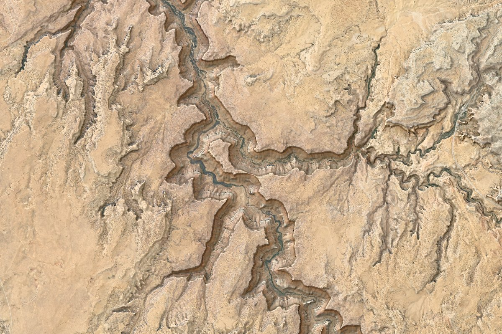
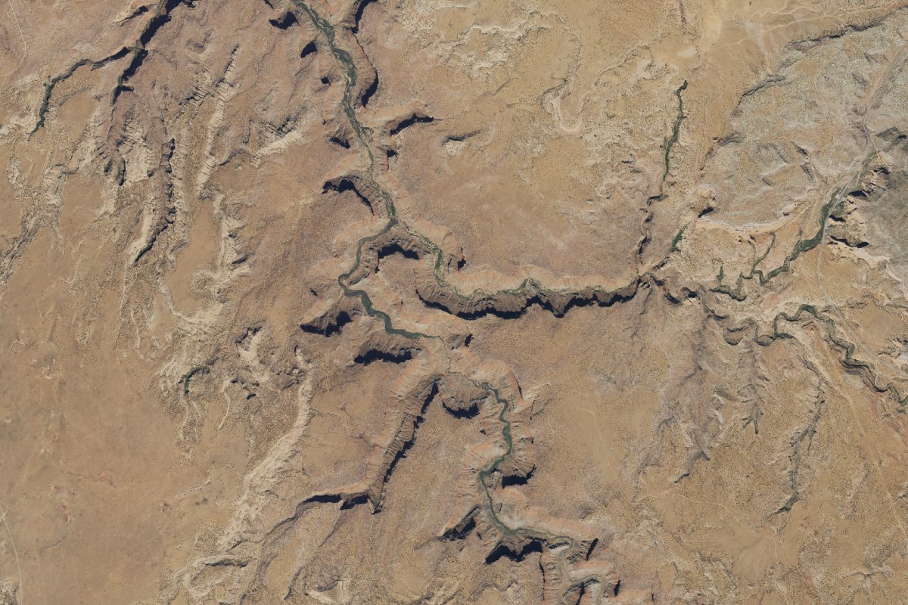
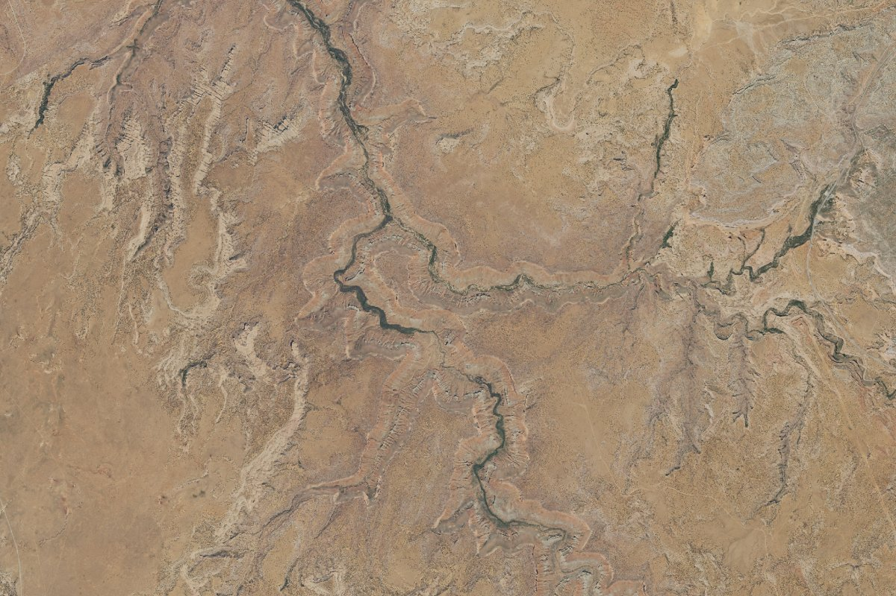
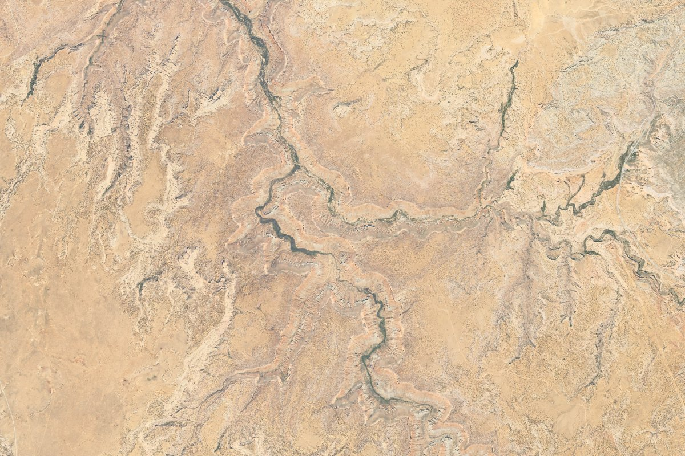

# Canyon relief

Difficulty: easy

### Steps

1. Create a map frame with the desired extent, projection and output size, e.g. by drawing a rectangle over Mapshaper's built-in basemap and running `-proj merc` for the Mercator projection (generally appropriate for smaller areas), then clicking "+ New frame" in the web UI.
2. Load a DEM (`-fetch 3dep-1m`).

3. Load imagery (`-fetch naip`).

4. Remove shadows from the aerial image (requires a DEM) (`-deshadow dem=3dep-1m`).

5. Adjust the color of the imagery (the sliders in the web UI make this easy) (`-tone lightness=1.49 saturation=1.18 contrast=1.23 hue-shift=0.25`)

6. Create the hillshade (`-target 3dep-1m -hillshade ambient=0.7 texture=0.1`)

7. Blend the hillshade and the imagery, sharpen a bit (`-blend 3dep-1m strength=1.15,1 chroma=0.9,1 -sharpen 0.25`)

