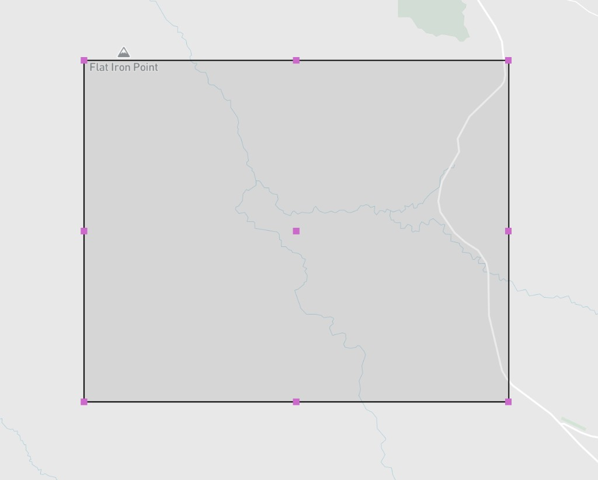
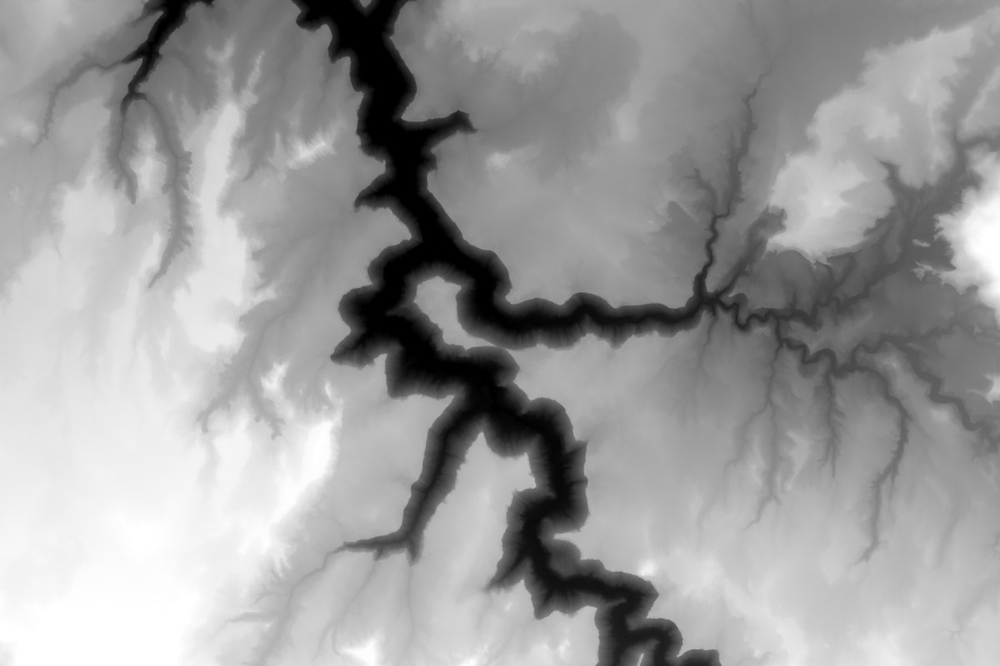
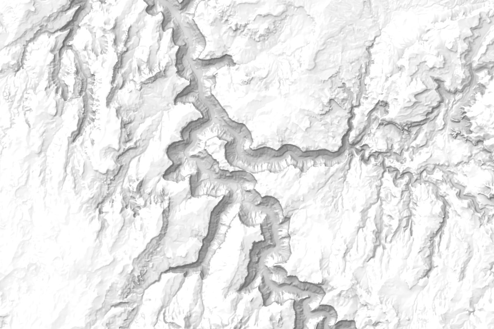

# Canyon relief

Difficulty: easy

### Steps

1. Draw a rectangle over the basemap, project it (`-proj merc`) and click **+ New frame**.

2. Load a DEM: `-fetch 3dep-1m`

3. Make a hillshade with the **hillshade** panel.

4. Load imagery: `-fetch naip`

5. Remove shadows from the imagery: `-deshadow dem=3dep-1m`

6. Adjust the colors of the imagery with the **adjust colors** panel.

7. Blend the hillshade with the imagery using the **blend hillshade** panel.

For details on each step, see the [Shaded relief](/docs/guides/shaded-relief.html.md) guide.
