# Shaded relief

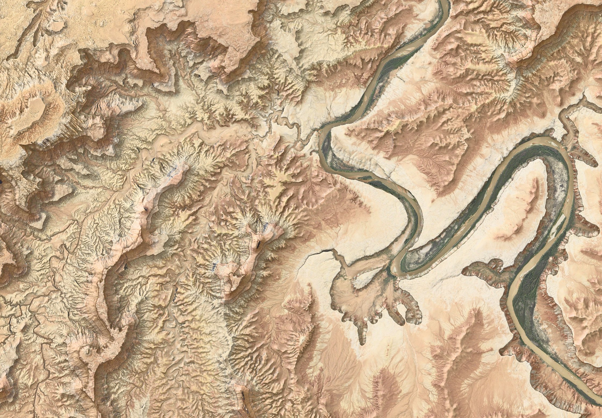

Mapshaper now has a set of tools for making shaded relief maps:

- the `-fetch` command downloads elevation data and imagery
- the `-resample`, `-blur` and `-smooth-terrain` commands change the resolution and level of detail of elevation data
- the **hillshade** panel turns an elevation raster into a hillshade
- the `-deshadow` command removes shadows from aerial imagery
- the **adjust colors** panel modifies the colors and contrast of image layers
- the **blend hillshade** panel combines a hillshade with imagery or a tinted raster
- the **color palette** panel colors an elevation raster with hypsometric tints
- the `-sharpen` command applies an unsharp mask to a hillshade or blended image.

Panels are opened from a layer's options menu in the layers panel, and commands are typed in the console.

## Create a hillshade

A hillshade is a raster layer that models the landscape with light and shadow, on its own or blended with aerial imagery or other layers. Cartographic hillshades aren't meant to be realistic renderings of sunlight on the land. They adjust the strength of relief to suit the map, sometimes exaggerating it, sometimes keeping it subtle, and they generalize detail so that terrain is legible and works as a base layer.

### Step one: get elevation data in a map frame

A **map frame** is a rectangle that defines the geographical extent of a map, its projection and its output size. When `-fetch` is run, the area to download, the coordinate system and the resolution are all taken from the frame.

There are two ways to get started.

#### Option one: draw a frame and download a DEM to fit it

1. Turn on a basemap (**Display &rarr; Basemaps**) to draw over, and zoom to your area of interest.

2. Choose **rectangles** from the **Draw** menu in the layers panel. Click one corner of the area you want to map, then click the opposite corner. Drag the handles to adjust the rectangle.

   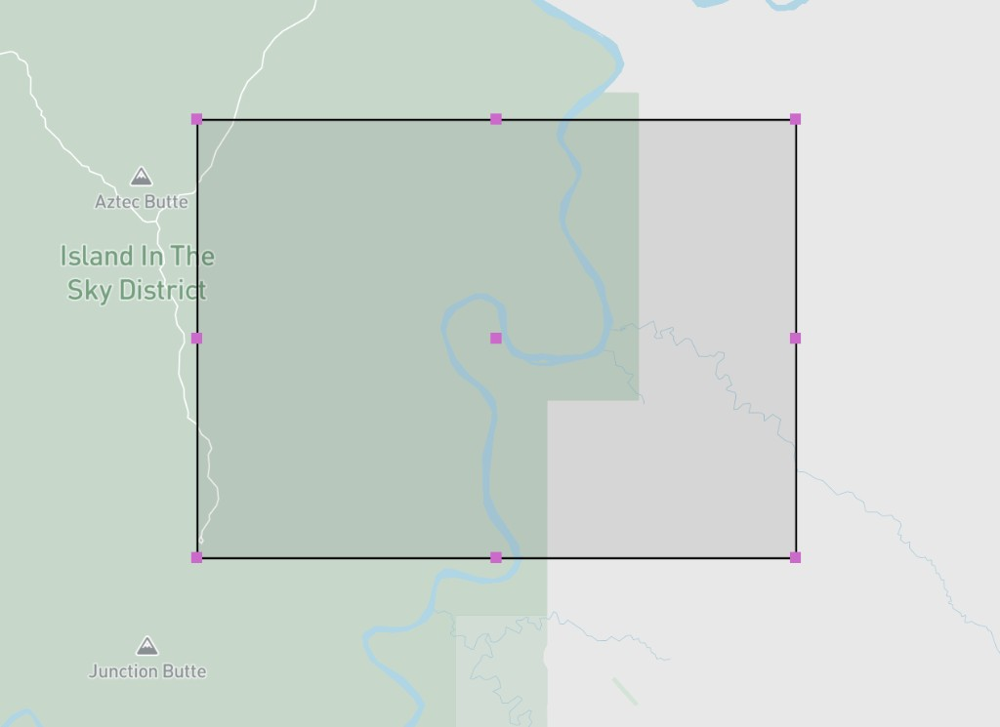

3. Reproject the rectangle to the projection you want for the finished map by typing a `proj` command in the console; for example, `proj merc` (Mercator, generally appropriate for small areas) or `proj lcc` (Lambert Conformal Conic, with parameters chosen to suit the extent of the rectangle). See [Map projections](/docs/guides/projections.html.md).

4. Click **+ New frame** in the layers panel, enter an output width and click **Fit visible layers**.

   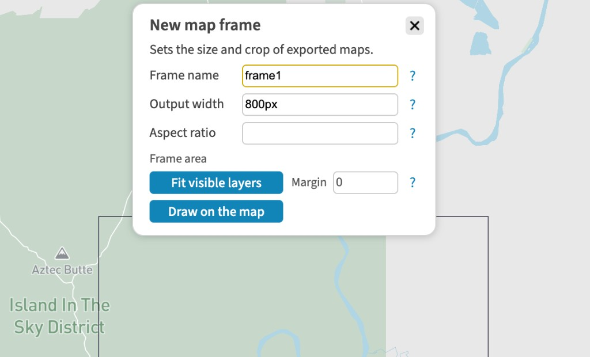

5. Download elevation data for the frame:

   ```bash
   -fetch mapterhorn
   ```

   The result should look something like this:

   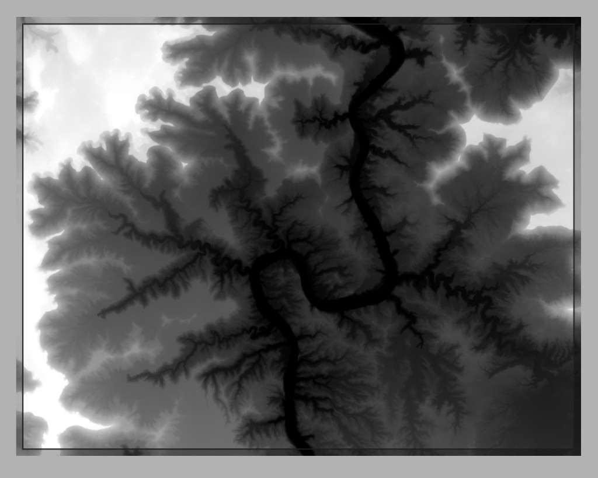

**Choosing an elevation source.** Run `-fetch sources` to see the full list. Many sources require attribution, and `-fetch` prints the credit to use.

| Source | Coverage | Resolution | Notes |
| --- | --- | --- | --- |
| `mapterhorn` | World | 30 m, finer where national lidar is available | Requires attribution. |
| `tilezen` | World | about 10 m in the U.S., 30-90 m elsewhere | Mostly public domain. |
| `copernicus` | World | 30 m | Requires attribution. |
| `3dep` | United States | 10 m | Public domain. |
| `3dep-1m` | United States | 1 m where there is lidar, 10 m or coarser elsewhere | Public domain. |

#### Option two: import your own DEM

1. Import a GeoTIFF containing elevation data.

2. If the DEM isn't in the projection you want for the map (for example, it uses lat-long coordinates or a different projected coordinate system), reproject it in one of two ways:

   - If you already have a frame in the projection you want (made as in [option one](#option-one-draw-a-frame-and-download-a-dem-to-fit-it)), drag the DEM into the frame in the layers panel. Mapshaper offers to reproject the DEM to match the frame; click **Yes**, then skip to step 4.
   - Otherwise, type a `proj` command in the console, for example `proj merc` or `proj lcc`.

3. Click **+ New frame** and choose **Fit visible layers** to create a frame around the DEM.

4. Match the DEM's resolution to the frame's output size. With the DEM layer selected, run [`-resample`](/docs/reference.html.md#-resample) in the console:

   ```bash
   -resample 2x crop
   ```

   `2x` sets two raster pixels per pixel of the frame, the resolution that `-fetch` uses by default. `1x` matches the frame's pixels, and a value like `300dpi` sets a resolution for print. `crop` discards the part of the DEM outside the frame, apart from a small margin (10 pixels by default, settable with `bleed=`).

### Step two: create a hillshade from the elevation layer

Select the elevation layer and choose **hillshade** from its options menu. The hillshade panel opens, and the map shows a live preview of the shading. Use the panel's controls to customize your hillshade and finalize it by clicking **Apply**.

The panel makes opaque hillshades. For a transparent hillshade, with translucent shadows and highlights, to stack over vector layers or use in other software, run [`-hillshade`](/docs/reference.html.md#-hillshade) in the console.

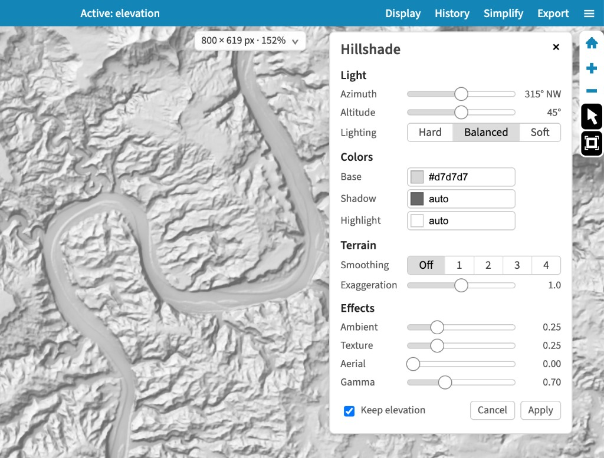

#### Light

- **Azimuth** is the direction of the main light source, in degrees clockwise from north. The default of 315° (northwest) lights the map from the upper left, which is the usual convention.
- **Altitude** is the angle of the light above the horizon (default 45°, a common convention). Mapshaper's hillshade function doesn't cast shadows. Altitude changes the tones of slopes rather than the length of shadows.
- **Lighting** sets the fill light. **Hard** uses the main light alone, **Balanced** (the default) adds fainter fill lights around it, and **Soft** adds still more.

#### Colors

The hillshade's tones run from a **Shadow** color through a **Base** color, which is the color of flat ground, to a **Highlight** color. By default, the shadow and highlight colors are *auto*: a darker shade and a lighter tint of the base color. To combine the hillshade with imagery or a tinted raster, use the **blend hillshade** panel (see [blend the hillshade with the image](#step-two-blend-the-hillshade-with-the-image)).

**Making a colored hillshade.** You can use a hillshade with custom shadow, base and highlight colors as a simple background layer for a map. Picking a cool shadow color and a warm highlight color gives the shading a hand-painted look, especially when smoothing is added.

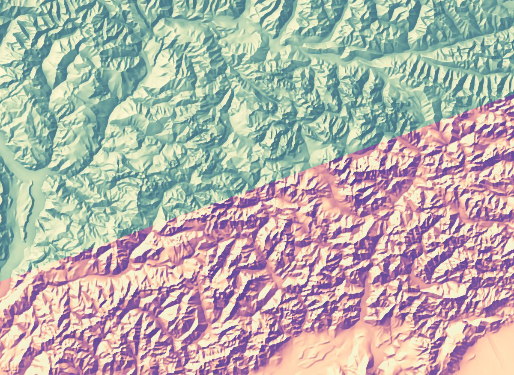

#### Terrain

- **Smoothing** (Off, 1-4) removes noisy detail while keeping major landforms sharp. Mapshaper's smoothing function adapts to the terrain, smoothing more or less according to the average slope in the immediate area. Smoothing changes only the hillshade; to smooth elevations for other uses, like contours or tints, use the [`-smooth-terrain`](/docs/reference.html.md#-smooth-terrain) or [`-blur`](/docs/reference.html.md#-blur) console command. The figure below shows the difference between no smoothing and maximum smoothing.
- **Exaggeration** adjusts the vertical scale of the terrain. The slider is centered on an automatic value based on the scale of the map (small-scale maps get more exaggeration).

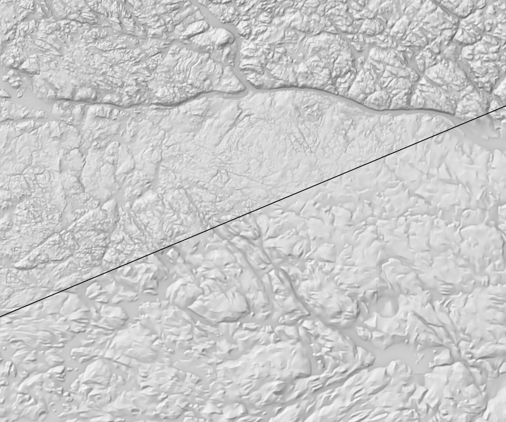

#### Effects

- **Ambient** darkens valleys, canyons and other places with a restricted view of the sky, adding depth to the image.
- **Texture** adds [*texture shading*](https://www.textureshading.com/Home.html), which emphasizes the pattern of ridges and valleys in uneven terrain.
- **Aerial** reduces contrast at low elevations, so that lowlands fade and high mountains stand out.
- **Gamma** controls the prominence of subtle terrain relative to major landforms. Values below 1 strengthen faint shading.

## Blend a hillshade with imagery

### Step one: prepare the imagery

#### Fetch imagery

With the map frame in place (see [get elevation data in a map frame](#step-one-get-elevation-data-in-a-map-frame)), run `-fetch` with the name of an imagery source, or import your own imagery.

```bash
-fetch naip
```

Built-in imagery sources:

| Source | Coverage | Resolution | Notes |
| --- | --- | --- | --- |
| `naip` | Conterminous U.S. | 0.3-1 m | Aerial photos. Use `year=` to choose a year; the default is the newest for each state. Public domain. |
| `usgs` | U.S. (world at small scales) | about 1 m | Faster than `naip`, mostly NAIP from 2017-2021. Public domain. |
| `sentinel2` | World | 10 m | Satellite image made from the least cloudy scenes of the summer of `year=` (the whole year in the tropics). The default is last year. Requires attribution. |
| `landsat` | World | 30 m | Satellite image made from the least cloudy scenes of the summer of `year=` (the whole year in the tropics), 1982 and later. The default is last year. 2012 has no usable scenes. Public domain. |
| `eox` | World | 10 m | Cloudless mosaic of Sentinel-2 images. Editions from 2018 on are licensed for non-commercial use only (CC BY-NC-SA 4.0). |
| `bluemarble` | World | 500 m | A smooth, cloud-free image for world and continental maps. |

#### Remove shadows from aerial imagery

Aerial photos often include shadows cast by the terrain. These tend to clash with the hillshade, which is almost always lit from a different direction. The experimental [`-deshadow`](/docs/reference.html.md#-deshadow) command uses a DEM to find shadowed areas and dark slopes, and relights them to a consistent brightness. With the imagery layer selected, run it with the name of a DEM layer.

```bash
-deshadow dem=mapterhorn
```

It also brightens small dark spots that are too fine for the DEM to account for, such as the shadows of ledges on bare rock. Add `no-despeckle` to brighten only the shadows that the DEM predicts.

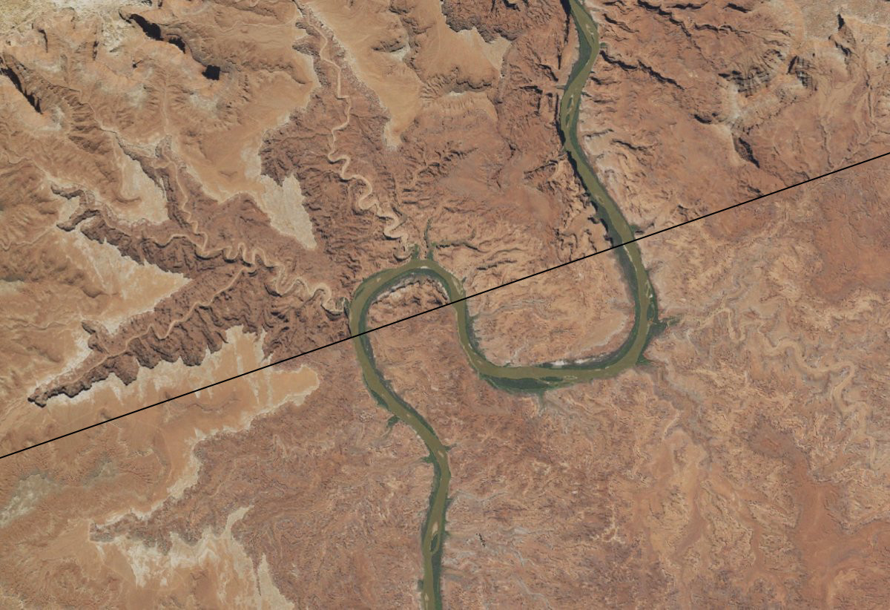

Composites of images taken at different times of day (like the built-in `naip` and `usgs` sources) combine regions with different sun angles. Mapshaper tries to detect these regions and correct each for its own sun angle, but detection isn't fully reliable. Results are also less reliable on images without distinct shadows.

#### Adjust the colors of the imagery

Most imagery benefits from color adjustment before blending. Select the imagery layer and choose **adjust colors** from its options menu to open the **Color & tone** panel.

### Step two: blend the hillshade with the image

Select the imagery layer and choose **blend hillshade** from its options menu. The item appears when there's a hillshade in the same map frame. The panel controls how the hillshade's shadows and highlights are combined with the image.

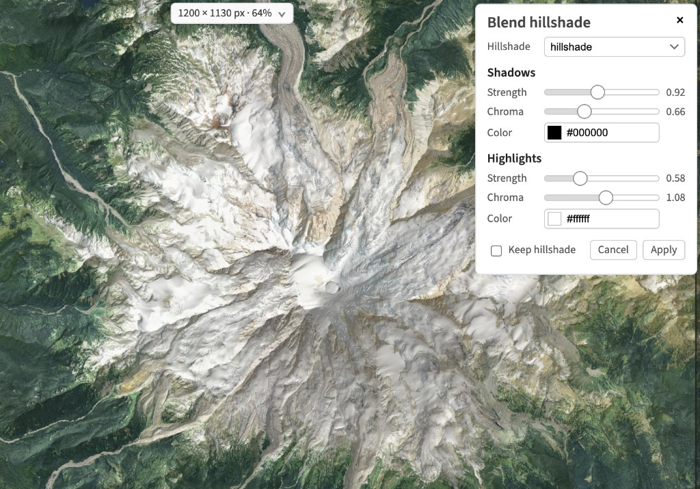

The **Shadows** and **Highlights** sections of the panel each have three settings. **Strength** sets the intensity of the shading. **Chroma** controls how the shading affects the image's colors. At 0, it works like an overlay of translucent black shadows and white highlights, which dulls shadowed areas and makes highlights look hazy; at 1, it works like a luminosity blend mode, changing lightness but keeping the image's color saturation. **Color** tints the shading wherever chroma is below 1.

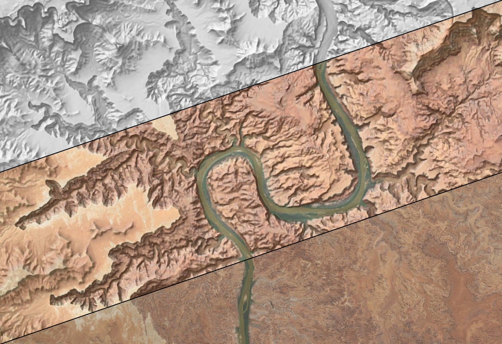

## Blend a hillshade with hypsometric tints

A **hypsometric tint** uses a color ramp to vary color by elevation. The example below colors lowlands green, highlands tan and the highest peaks white, like a relief map in an atlas.

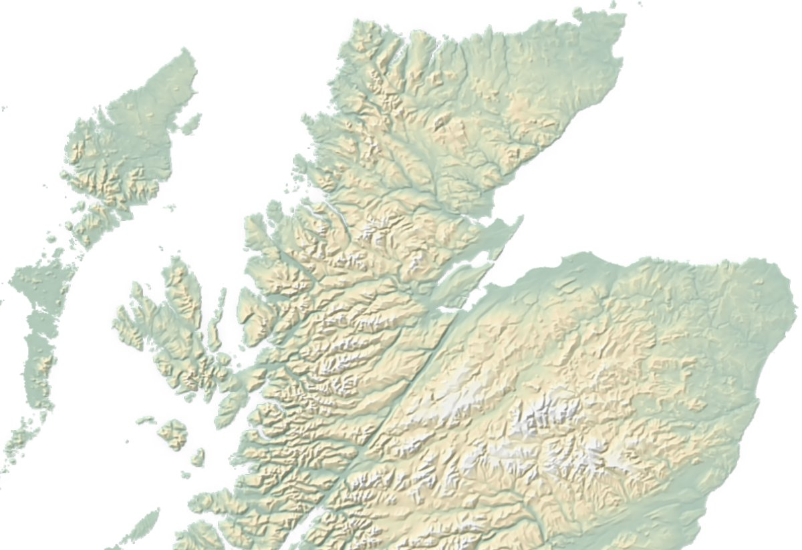

First, make a hillshade (see [create a hillshade from the elevation layer](#step-two-create-a-hillshade-from-the-elevation-layer)), then choose **color palette** from the DEM's options menu and pick a hypsometric color ramp from the **Elevation** tab. To fit the colors to the terrain of your map, click **Customize** to open the **Elevations and colors** dialog, where you can move, add, remove and recolor the color stops.

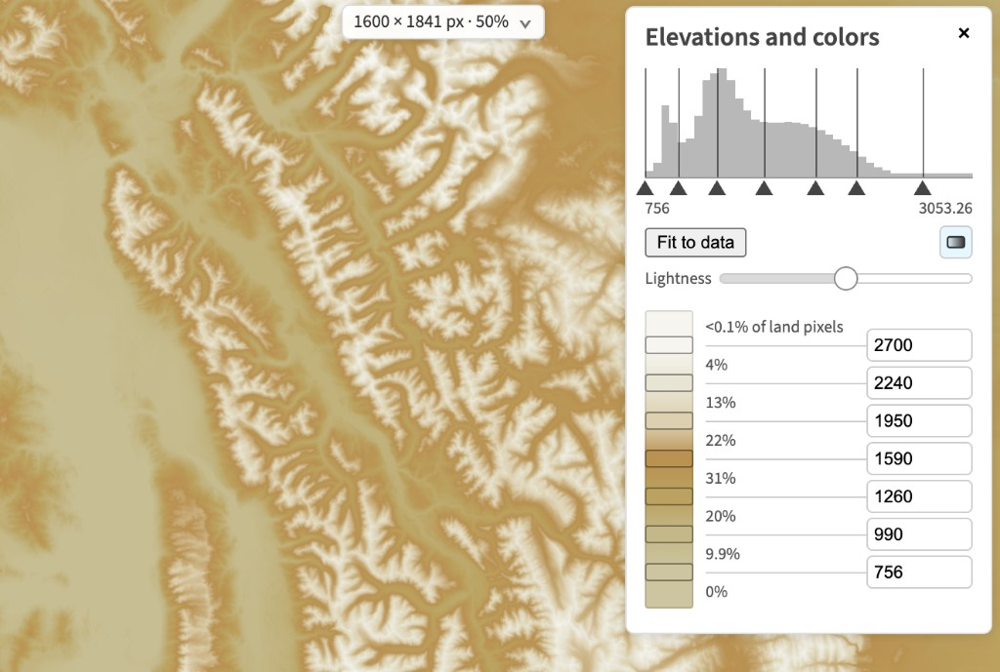

Finish by blending the tinted elevation layer with a hillshade, as in [blend the hillshade with the image](#step-two-blend-the-hillshade-with-the-image).

## Blend a hillshade with polygons

A hillshade can also be blended with a layer of colored polygons.

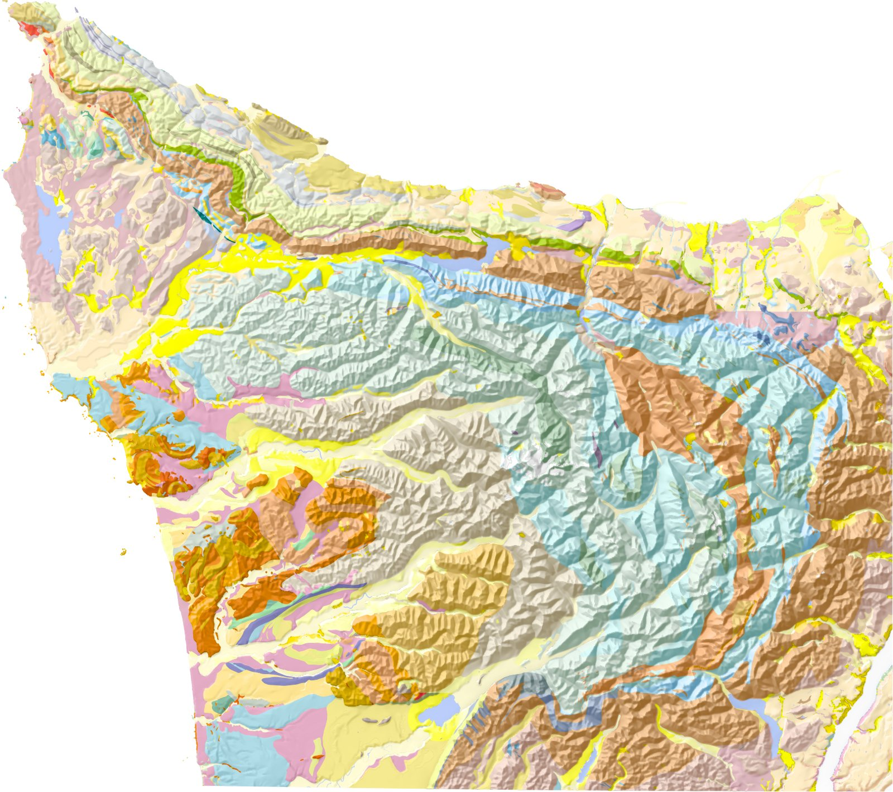

Start with a hillshade and a polygon layer in the same map frame (see [create a hillshade from the elevation layer](#step-two-create-a-hillshade-from-the-elevation-layer)). Select the polygon layer, choose **blend hillshade** from its options menu, and adjust the settings as in [blend the hillshade with the image](#step-two-blend-the-hillshade-with-the-image). For polygon layers the panel has two more settings:

- **Output** sets what the blend makes. **Overlay** keeps the polygons as vector shapes and replaces the hillshade with a transparent layer that gives the blended appearance when it is overlaid on the polygons. **Image** replaces the polygons with a blended image.
- **Clip to polygons** removes the portion of the hillshade outside the polygons.

## See also

- [`-fetch`](/docs/reference.html.md#-fetch), [`-hillshade`](/docs/reference.html.md#-hillshade), [`-blend`](/docs/reference.html.md#-blend), [`-tone`](/docs/reference.html.md#-tone), [`-deshadow`](/docs/reference.html.md#-deshadow), [`-resample`](/docs/reference.html.md#-resample), [`-blur`](/docs/reference.html.md#-blur), [`-sharpen`](/docs/reference.html.md#-sharpen), [`-smooth-terrain`](/docs/reference.html.md#-smooth-terrain) and [`-classify`](/docs/reference.html.md#-classify) in the command reference
- [Canyon relief](/docs/examples/canyon.html.md), a shorter worked example
- [Map projections](/docs/guides/projections.html.md)
