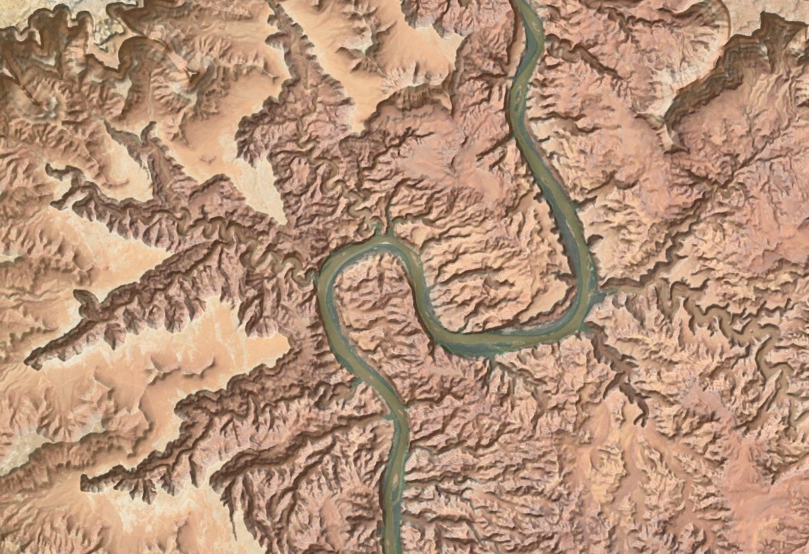
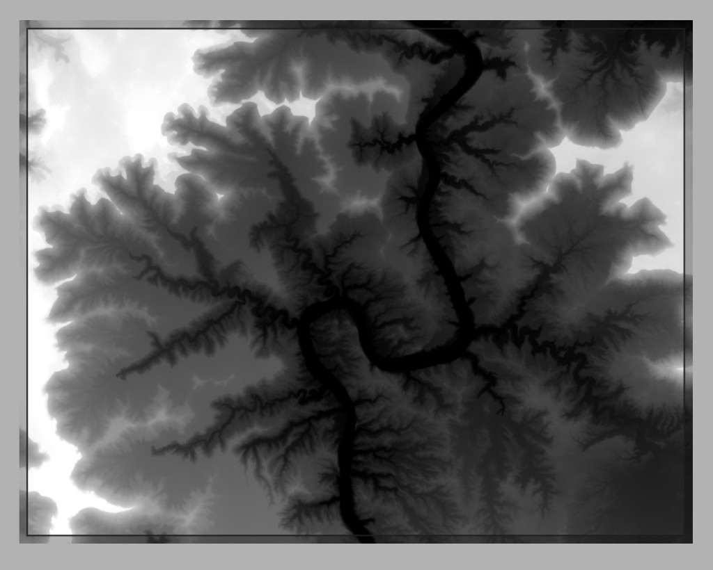
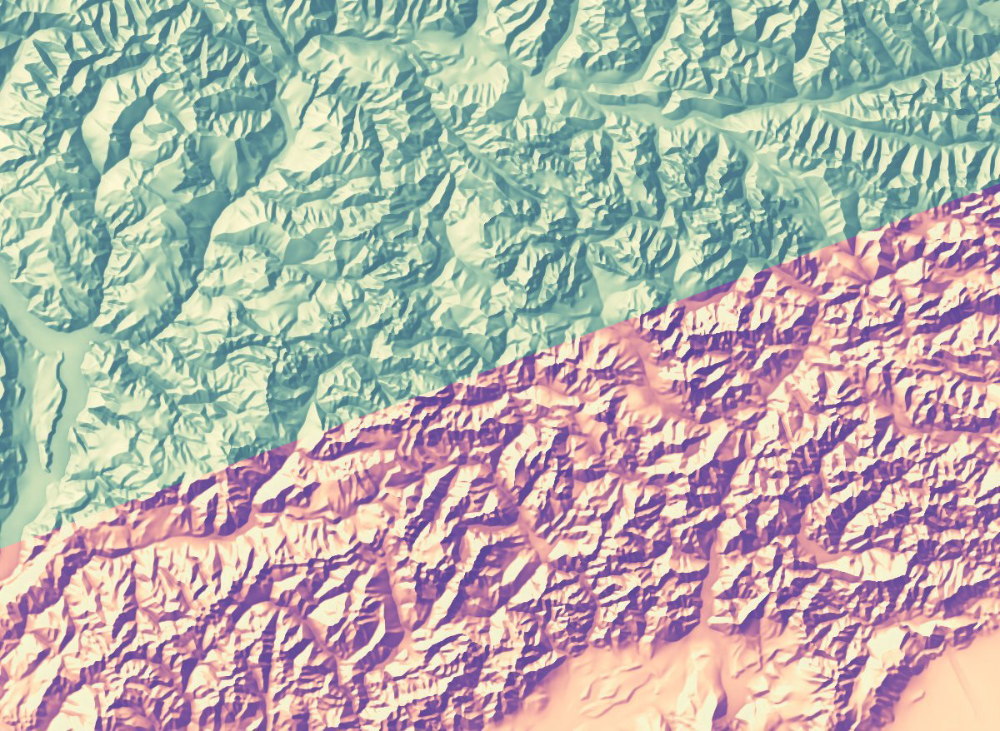
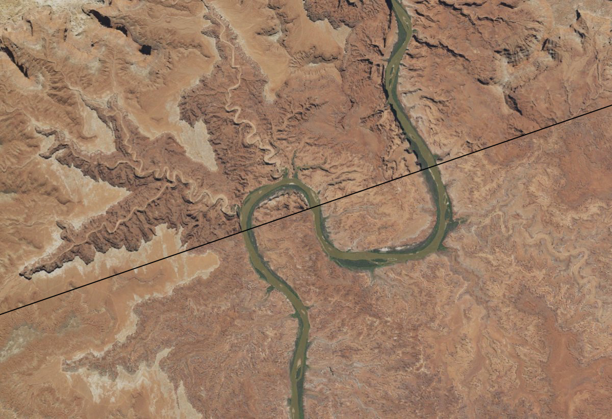
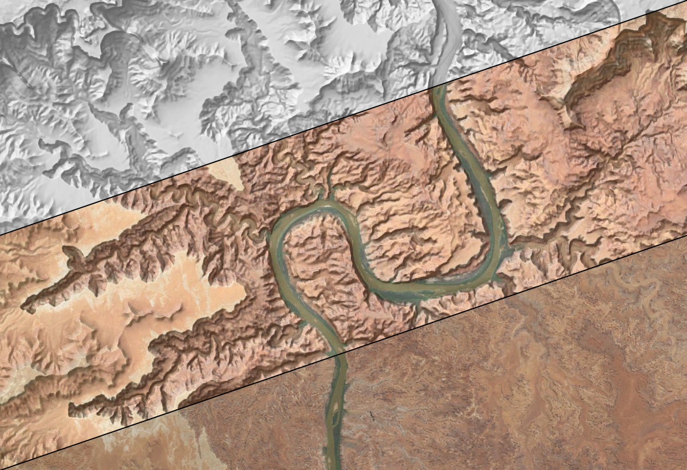
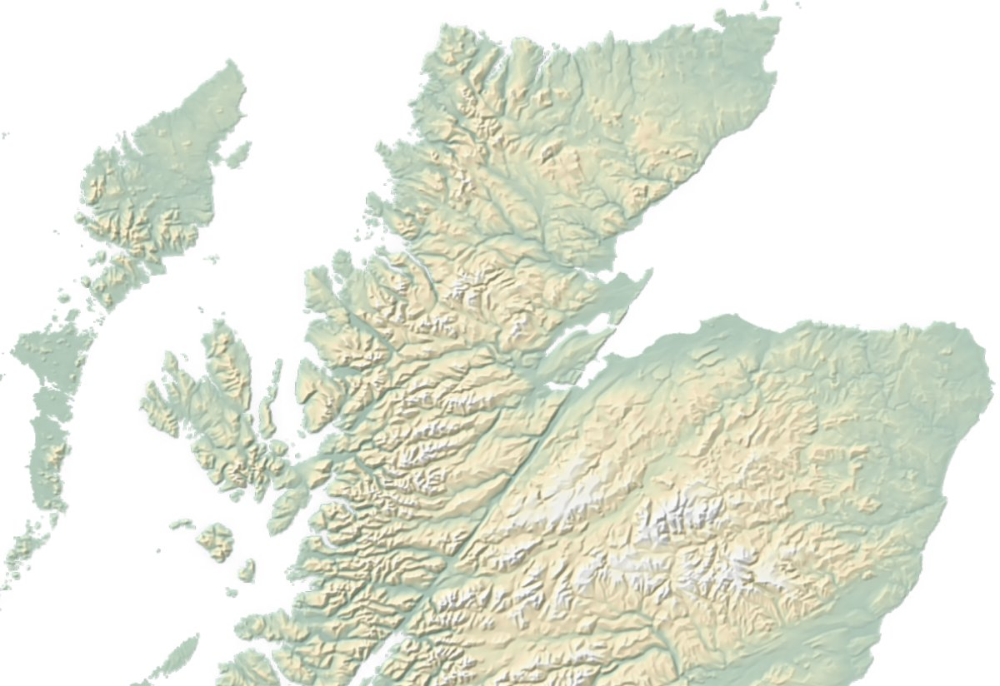
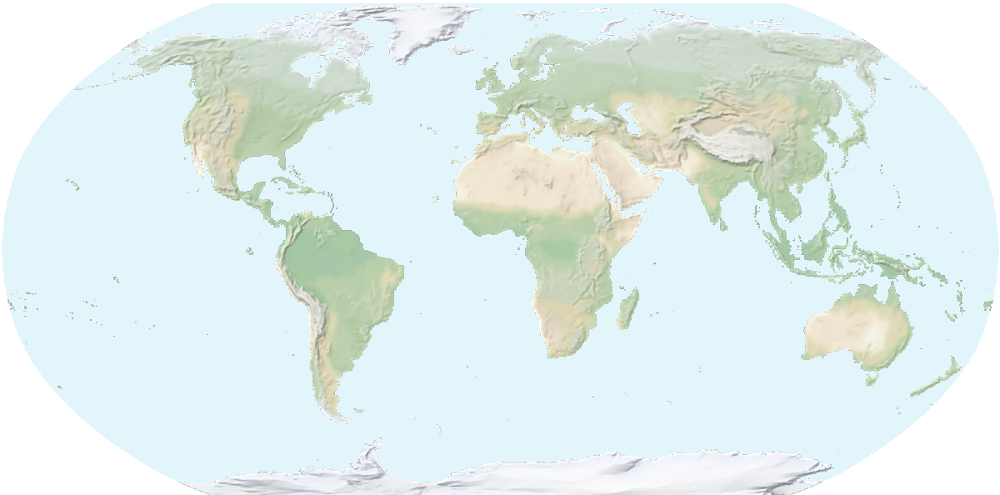

<!--
DRAFT NOTES (delete before publishing)
- Image placeholders look like:  > **[IMAGE: filename.jpg]** description
  Replace each with .
- Open questions for the author are marked  > **[TODO]**
-->

# Shaded relief



Mapshaper can build shaded relief maps from start to finish, using the `-fetch` command to download elevation data and imagery and a set of new interactive panels and console commands to transform the source data into shaded relief:

- the **hillshade** panel turns an elevation raster into shaded relief
- the **adjust colors** panel changes the lightness, saturation, contrast and hue of imagery
- the **color palette** panel colors an elevation raster with hypsometric tints
- the **blend hillshade** panel combines a hillshade with imagery or a tinted raster
- the **-deshadow** command removes shadows from hi-res aerial imagery

The interactive panels run ordinary Mapshaper commands under the hood. You can view the commands by typing `history` in the console. See [Putting it together](#putting-it-together).

## Before you start

**Finding the tools.** Panels are opened from a layer's menu in the layers panel (the menu button at the right of the layer's entry).

| To do this | Open this on the layer | On this kind of layer |
| --- | --- | --- |
| Make a hillshade | **hillshade** | an elevation raster |
| Change the colors of an image | **adjust colors** | an RGB image |
| Color elevations with a tint | **color palette** | an elevation raster |
| Blend a hillshade with another raster | **blend hillshade** | an image or a tinted raster, in the same frame as a hillshade |

**Commands without panels.** `-fetch` and `-deshadow` are run from the console (press the **space bar** to open it). The leading `-` is optional for a single console command, e.g. `fetch 3dep-1m`.

## Part one: create a hillshade

A hillshade is a raster image that makes terrain easy to read and pleasing to look at on a map. Cartographic hillshades aren't meant to be realistic renderings of sunlight on terrain. They exaggerate relief, bring out ridges and valleys, and generalize detail, so that the terrain looks good and works as a base layer without competing with the rest of the map.

The hillshade panel has controls for generalizing terrain, adjusting shading and adding optional tints:

- **Terrain smoothing:** Mapshaper uses a variation of feature-preserving smoothing that adapts the amount of smoothing to the steepness of the terrain.
- **Special effects** can be combined and adjusted separately: vertical exaggeration, multiple fill lights, ambient darkening of valleys, texture shading, aerial perspective and a tone curve.
- **Tinting.** An opaque hillshade can be given custom base, shadow and highlight colors. Tinting can also be applied when the hillshade is blended with imagery or other base layers.

### Step one: get elevation data in a map frame

A **map frame** is a rectangle that defines the geographical extent of a map, its projection and its output size. When `-fetch` is run, the area to download, the coordinate system and the resolution are all taken from the frame. The frame's size and crop also apply when the finished map is exported.

There are two ways to get started.

#### Option one: draw a frame and download a DEM to fit it

1. Turn on a basemap (**Display &rarr; Basemaps**) to draw over, and zoom to your area of interest.

   > **[IMAGE: shaded-relief-frame-1-basemap.png]** The basemap with the area of interest in view.

2. Choose **rectangle tool** from the arrow menu and shift-drag to draw a rectangle around the area you want to map.

3. Project the rectangle into the projection you want for the finished map, e.g. `proj merc` (Mercator, generally appropriate for small areas), `proj albersusa` for the contiguous U.S., or `proj eqearth` for a world map. See [Map projections](/docs/guides/projections.html).

   > **[TODO]** Confirm the best recommendation for readers choosing a projection (maybe link to a short list of good defaults by map scale).

4. Click **+ New frame** in the layers panel, enter an output width (e.g. `1200px`) and click **Fit visible layers**.

   > **[IMAGE: shaded-relief-frame-2-dialog.png]** The New map frame dialog.

5. Download elevation data for the frame:

   ```bash
   -fetch mapterhorn
   ```

   The new raster layer takes its area, projection and resolution from the frame.

   

**Choosing an elevation source.** Run `-fetch sources` to see the full list.

| Source | Coverage | Resolution | Notes |
| --- | --- | --- | --- |
| `mapterhorn` | World | 30 m, finer where national lidar is available | Good first choice for most maps. Requires attribution. |
| `tilezen` | World | about 10 m in the U.S., 30-90 m elsewhere | Mostly public domain. |
| `copernicus` | World | 30 m | Requires attribution. |
| `3dep` | United States | 10 m | Public domain. |
| `3dep-1m` | United States | 1 m where there is lidar, 10 m or coarser elsewhere | Public domain. Slow for large areas (tiles are rendered on demand). Best for detailed, large-scale maps. |

> **[TODO]** Confirm the "good first choice" recommendation and add a sentence on how many tiles/how long a typical fetch takes. `max-tiles=` (default 500) stops runaway downloads; mention it here or in a tip.

Run `-fetch` *after* creating the frame and projecting your data. A fetched raster is a snapshot of the frame at the time of the download, so if you change the projection or resize the frame afterward, fetch again.

#### Option two: import your own DEM

A DEM from a national mapping agency, [OpenTopography](https://opentopography.org/) or another source can be used instead of `-fetch`.

1. Import the GeoTIFF. Select **with advanced options** in the import dialog and add `raster-type=continuous`, which keeps nodata pixels from being mixed with real values when the DEM is reprojected.

2. If the DEM is in lat-long coordinates, reproject it, e.g. `proj albersusa` or `proj merc`. Make the hillshade after reprojecting, so that the light direction is fixed relative to the page and the shading matches the output pixel size.

3. If the DEM covers a much larger area than the map, clip it with the rectangle tool or [`-clip`](/docs/reference.html#-clip) to reduce processing time. (Step 5 can also crop the DEM to the frame.)

4. Click **+ New frame** and choose **Fit visible layers** to create a frame around the DEM.

   > **[IMAGE: shaded-relief-import-dem.png]** An imported DEM with a frame.

5. Match the DEM's resolution to the frame. A hillshade's appearance depends on raster resolution, because smoothing, ambient darkening and texture shading work over distances measured in pixels, and the automatic exaggeration is based on the ground size of a pixel. With the DEM layer selected, run [`-resample`](/docs/reference.html#-resample) in the console:

   ```bash
   -resample 2x crop
   ```

   `2x` sets two raster pixels per pixel of the frame, the resolution `-fetch` uses. `1x` matches the frame's pixels, and a value like `300dpi` sets a resolution for print. `crop` discards the part of the DEM outside the frame, apart from a small margin (`bleed=`, 10 pixels by default) that keeps edge effects out of the hillshade.

Elevation data from `-fetch` is already at the frame's resolution and cropped to the frame, so it doesn't need this step. From here on, fetched and imported DEMs are handled the same way.

### Step two: create a hillshade from the elevation layer

Select the elevation layer and choose **hillshade** from its menu. The hillshade panel opens, and the map shows a live preview of the shading. Use the panel's controls to customize your hillshade and finalize it by clicking **Apply**. **Keep elevation** (checked by default) keeps the DEM, which is needed for tints and for `-deshadow`.

> **[IMAGE: shaded-relief-panel-overview.png]** The hillshade panel beside a preview of the map.

#### Shading: opaque or transparent

The panel's **Style** setting controls how the hillshade is drawn.

- **Opaque** colors every pixel, running from a *shadow* color through a *base* color, which is the color of flat ground, to a *highlight* color.
- **Transparent** is drawn translucent black shadows and white highlights, so the layers below the hillshade show through. Flat ground is fully transparent.

For the most control over how a hillshade is combined with another layer, make an opaque hillshade and blend the layers using the "Blend hillshade" panel.

> **[IMAGE: shaded-relief-style-compare.jpg]** The same terrain in the two styles: opaque (left) and transparent over a colored layer (right).

**Making a colored hillshade.** An opaque hillshade with a colored base is a quick way to make a stand-alone relief map. Choose a base color (try a light tan or a pale green-gray), and adjust the shadow and highlight colors until the result looks right. A cool shadow color and a warm highlight color give the shading a hand-painted look, especially when smoothing is added.



#### Light

- **Azimuth** is the direction of the main light, in degrees clockwise from north. The default of 315° (northwest) lights the map from the upper left, which is the usual convention.
- **Altitude** is the angle of the light above the horizon (default 45°, a common convention). Mapshaper doesn't cast shadows, so altitude changes tones rather than the length of shadows.
- **Lighting** adds fainter fill lights around the main light. **Hard** uses the main light alone, **Balanced** (the default) softens contrast, and **Soft** adds still more fill light, brightening slopes that face away from the main light.

> **[IMAGE: shaded-relief-light-compare.jpg]** Hard, balanced and soft lighting, side by side.

#### Terrain

- **Exaggeration** multiplies the vertical scale of the terrain. The slider is centered on an automatic value based on the scale of the map (small-scale maps get more exaggeration), and the readout shows the value in use.
- **Smoothing** (Off, 1-4) removes noise and small landforms while keeping ridges and valleys sharp. Higher levels remove larger features. Smoothing only changes the hillshade. To smooth elevations for other uses, like contours or tints, use [`-smooth-terrain`](/docs/reference.html#-smooth-terrain).

> **[IMAGE: shaded-relief-smoothing-compare.jpg]** A mountainous area at smoothing Off, 1, 2 and 3 (or similar).

#### Effects

- **Ambient** darkens valleys, canyons and other places with a restricted view of the sky, adding depth that a single light can't.
- **Texture** adds *texture shading*, which emphasizes the pattern of ridges and valleys in rugged terrain, even where they are not oriented to the light.
- **Aerial** reduces contrast at low elevations, so that lowlands fade and high mountains stand out, like atmospheric haze.
- **Gamma** sets the shape of the tone curve where slopes meet flat ground. Values below 1 strengthen faint shading, so that gentle terrain is more visible.

> **[IMAGE: shaded-relief-effects-compare.jpg]** The same terrain with ambient, texture and aerial added one at a time.

> **[TODO]** Add a suggested starting recipe, e.g. "For rugged terrain, try ambient 0.7 and texture 0.1" (these are the settings used in the Canyon example).

#### Other options

A few settings have no sliders and are available in the console:

- `-hillshade min-elevation=0` flattens the sea floor at sea level, which keeps the sea clear of shading.
- [`-sharpen`](/docs/reference.html#-sharpen) applies an unsharp mask to the finished hillshade, which brings out ridgelines on high-resolution maps.
- `-hillshade verbose` prints every setting, including the automatic ones.

## Part two: blend a hillshade with imagery

Draping a transparent hillshade over a satellite image often looks muddy: shadows desaturate the colors and highlights lay a white haze over them. The **blend hillshade** panel combines the two layers pixel by pixel, so the hillshade adjusts the lightness of the image while the colors stay true.

### Step one: prepare the imagery

#### Fetch imagery for the frame

With the map frame in place (see [part one](#step-one-get-elevation-data-in-a-map-frame)), run `-fetch` with the name of an imagery source:

```bash
-fetch naip
```

> **[IMAGE: shaded-relief-fetch-imagery.jpg]** NAIP aerial imagery in the frame.

| Source | Coverage | Resolution | Notes |
| --- | --- | --- | --- |
| `naip` | Conterminous U.S. | 0.3-1 m | Aerial photos. Use `year=` to choose a year; the default is the newest for each state. Public domain. |
| `usgs` | U.S. (world at small scales) | about 1 m | Faster than `naip`, mostly NAIP from 2017-2021. Public domain. |
| `sentinel2` | World | 10 m | Satellite image, season of `year=` (default is last year). Requires attribution. |
| `landsat` | World | 30 m | Satellite image. Public domain. |
| `eox` | World | 10 m | Cloudless mosaic of Sentinel-2 images. 2018 and later editions are non-commercial. |
| `bluemarble` | World | 500 m | A smooth, cloud-free image for world and continental maps. |

> **[TODO]** Add a sentence on which imagery source is recommended at which map scale (e.g. `bluemarble` for the world, `eox` or `sentinel2` for regions, `naip` for local maps).

#### Remove shadows from aerial imagery

Aerial photos include real shadows, cast by the terrain when the picture was taken. These clash with the shading of the hillshade, which is lit from a different direction. The experimental [`-deshadow`](/docs/reference.html#-deshadow) command uses the DEM to find shadowed areas and dark slopes, and relights them to a consistent brightness. With the imagery layer selected, run it with the name of the DEM layer (named after its source):

```bash
-deshadow dem=mapterhorn
```

Add `despeckle` to also brighten small dark spots that the DEM doesn't account for, such as the small shadows of features too fine to appear in the DEM. Which shadows count as small depends on the resolution of the imagery. It works best on bare rock and areas with little vegetation.



Shadow removal works best on high-resolution aerial images with distinct shadows, such as canyons and mountains. Composites of images taken at different times of day, such as mosaics of aerial photos, have regions with different sun angles. Mapshaper tries to detect these regions and correct each for its own sun angle, but detection isn't fully reliable, so check the result. Results are also less reliable on images without distinct shadows.

> **[TODO]** Test `-deshadow` on `eox`, `sentinel2` and `landsat` imagery in a few regions (including high latitudes) and say which, if any, it helps.

The DEM must still be present when `-deshadow` runs, so keep the elevation layer when making the hillshade (or run `-deshadow` first).

#### Adjust the colors of the imagery

Select the imagery layer and choose **adjust colors** to open the **Color & tone** panel. **Apply** commits the change as a [`-tone`](/docs/reference.html#-tone) command.

> **[IMAGE: shaded-relief-tone-panel.png]** The Color & tone panel.

Aim for an image that is a little brighter, more colorful and lower in contrast than the final result you want: the hillshade supplies the contrast, and shading lowers lightness. If the image is dark before blending, shadows have little room to show. The Canyon example used `-tone lightness=1.49 saturation=1.18 contrast=1.23 hue-shift=0.25`.

### Step two: blend the hillshade with the image

Make an opaque hillshade (see [part one](#step-two-create-a-hillshade-from-the-elevation-layer)), then select the imagery layer and choose **blend hillshade** from its menu. The item appears when a hillshade is in the same frame as the imagery.

> **[IMAGE: shaded-relief-blend-panel.png]** The blend hillshade panel beside a preview.

The **Shadows** and **Highlights** sections each have **Strength**, **Chroma** and **Color** settings.

#### Strength

**Strength** multiplies the opacity of the shading: 0 turns it off, 1 is the hillshade as drawn, and higher values strengthen it. Raise the shadow strength on dark imagery such as forest, where shadows are faint.

#### Chroma

**Chroma** controls how much of the image's own color is kept under the shading.

- At **0**, shading works like an ordinary overlay of semi-transparent black or white. Shadows darken and dull the colors, and highlights make them pale and hazy.
- At **1**, the image keeps its original hue and saturation, and the shading only changes lightness (similar to the *luminosity* blend mode in graphics programs). Shadowed forest stays green, and sunlit slopes are brighter without turning milky.
- Values above 1 boost saturation beyond the image's original colors.

The defaults are 0 for shadows and 1 for highlights, so that highlights have no haze. Raise the shadow chroma to 0.5 or higher if shadows make the map look dull.

> **[IMAGE: shaded-relief-chroma-compare.jpg]** Shadow chroma at 0, 0.5 and 1.

#### Tinting the shading

Each section's **Color** sets the color of the shading. A color's hue appears wherever chroma is below 1, so lower the chroma when tinting. Its lightness matters at every setting: a lighter shadow color makes shadows fainter.

For example, for cool blue-violet shadows and warm highlights, choose `#2a2550` for the shadows and `#fff3d6` for the highlights, and set both chroma values to about 0.5.

> **[IMAGE: shaded-relief-tinted-shadows.jpg]** Neutral shading compared with cool, blue-green and purple shadow tints.

> **[TODO]** Try a few good-looking tint colors (a cool green, a blue and a purple) and list their hex values here.

#### Finishing

**Apply** runs [`-blend`](/docs/reference.html#-blend), which replaces the imagery with the blended image and removes the hillshade layer unless **Keep hillshade** is checked. To adjust a blend, undo it (**⌘Z** / **Ctrl+Z**) and blend again. Blending the output a second time doubles the shading.



## Part three: blend a hillshade with hypsometric tints

A **hypsometric tint** colors land by elevation: lowlands green, highlands tan and brown, and the highest peaks white, for example. Combined with a hillshade, tints give the classic look of an atlas relief map.



### Coloring an elevation layer

1. Select the DEM layer and choose **color palette** from its menu. Click the **Elevation** tab.
2. Choose a palette from the palette menu:

   - **Climate zones** (*desert*, *steppe*, *tropical*, *temperate*, *boreal* and *polar*) are tints suited to different climates.
   - **Blended** mixes the climate palettes according to the climate at each location. It's designed for maps of the world and of large regions, and is offered when the raster's location is known.
   - **Other** has the general-purpose *atlas*, *lowland* and *highland* palettes.
   - **Transparent** leaves the land uncolored.

3. The **Sea** menu colors the ocean by depth (**Bathymetry** palettes) or leaves it uncolored (**Transparent**). The sea is the area at or below sea level that connects to the edge of the map. Lakes and basins below sea level, such as the Dead Sea, are not tinted as sea.

A palette is a display setting that leaves the elevation values unchanged, so the DEM can still be used for hillshades and contours. The panel creates a [`-classify`](/docs/reference.html#-classify) command, e.g. `-classify land-colors=temperate sea-colors=blue`.

> **[IMAGE: shaded-relief-palette-panel.png]** The color palette panel with the Elevation tab showing.

### Example: a world map

1. Create a frame in a world projection (for example `proj eqearth`) about 1200px wide. See [part one](#option-one-draw-a-frame-and-download-a-dem-to-fit-it).
2. `-fetch tilezen` (or `mapterhorn`).
3. Make a hillshade with **Keep elevation** checked. At small scales the automatic exaggeration is high, which makes continents look three-dimensional. Increase **Smoothing** to remove detail that doesn't belong at this scale.
4. On the DEM, open **color palette** and choose **Blended** for land and a **Bathymetry** palette for the sea.
5. Blend the hillshade with the tinted DEM (see below).



> **[TODO]** Confirm the cleanest way to start a world map session in the web app (what to import so there is a layer to project and fit a frame to). Could use the `-rectangle` command with `bbox=-180,-85,180,85`.

### Example: a regional map with custom elevation breaks

Preset tints have fixed elevations, and a particular area may suit different ones. On a map of the Colorado Plateau, the useful color changes fall between 1500 and 2500 meters, while on a map of the Netherlands they fall between 0 and 50.

**Customize** opens the **Elevations and colors** dialog, where color stops can be moved, added, deleted and recolored. The command-line equivalent is `land-colors=` with `land-breaks=`, which lists the elevation of each color, lowest first:

```bash
-classify land-colors=#b2c9ba,#e8dcb5,#c8a47e,#8a6b4f,#f4efe6 land-breaks=0,300,900,1800,3000
```

> **[IMAGE: shaded-relief-tint-regional.jpg]** A regional map, with the Elevations and colors dialog open.

> **[TODO]** Choose a real region for this example, and record its break values.

### Blending a hillshade with the tints

The blend hillshade panel works on rasters displayed in color, which includes an elevation raster with a palette. Blending replaces its target with a new image, so **duplicate the DEM** (**duplicate layer** in its menu) and apply the palette to the copy to keep the original elevations.

Then select the tinted layer, open **blend hillshade** and adjust the settings as in [part two](#step-two-blend-the-hillshade-with-the-image). Tinted terrain is usually lighter than imagery, so shadows show clearly at the default strength. A shadow chroma of 0.5 to 1 keeps tint colors from dulling in dark areas.

> **[IMAGE: shaded-relief-tint-blend-compare.jpg]** A tint alone, a hillshade alone, and the blend.

### Overlaying tinted water and transparent land

Choosing **Transparent** for the land palette and a **Bathymetry** palette for the sea (`-classify sea-colors=blue`) makes a layer in which only the water is colored. This is useful when the land is drawn some other way, for example with blended imagery, and only the ocean should be tinted by depth.

1. Make a hillshade and a land layer (imagery or a tint) and blend them.
2. Duplicate the DEM and give the copy a sea-only palette.
3. Stack the sea layer above the land. To let the land show through the water, lower the sea layer's opacity in the console, e.g. `-style opacity=0.6`.

> **[IMAGE: shaded-relief-water-overlay.jpg]** Blended land with a depth-tinted sea overlaid.

> **[TODO]** This section is the least developed part of the outline. Decide the intended workflow: (a) a sea-only palette on top of blended land, (b) a land palette with transparent sea on top of a bathymetry layer, or (c) a transparent hillshade over a basemap. Update the steps and image accordingly.

## Part four: blend a hillshade with a choropleth map

A transparent hillshade placed over a choropleth map tends to wash out the data classes. Blending the hillshade with the colors keeps them legible.

The blend hillshade *panel* works on rasters, so polygon layers are blended with the [`-blend`](/docs/reference.html#-blend) command in the console. It draws the named layers at the hillshade's resolution and blends them in the same way as an image.

1. Import your polygons, project them, and create a frame (see [part one](#step-one-get-elevation-data-in-a-map-frame)). The polygons and the hillshade must be in the same projection.
2. `-fetch` a DEM and make an opaque hillshade of it. Use gentle settings (lower **Shadows** and **Highlights**, a bit of **Smoothing**), since strong shading competes with the data colors.
3. Color the polygons with the **color palette** panel or with [`-classify`](/docs/reference.html#-classify).
4. Select the polygon layer, and run (`hillshade` is the name of the hillshade layer):

   ```bash
   -blend hillshade target=counties
   ```

   The polygon layer is replaced by a raster image, and the hillshade layer is removed.

> **[IMAGE: shaded-relief-choropleth.jpg]** A choropleth map of counties blended with shaded relief.

**Keeping the vector layers.** Add `overlay` to keep the polygons as vector layers:

```bash
-blend hillshade target=counties overlay
```

The overlay is a layer that produces the blended look when drawn directly above the polygons. The polygons stay crisp, editable and exportable as paths. If you restyle them, run `-blend` again.

**Tips**

- At chroma 1 the hues of the color scheme are unchanged, so map colors still match the legend, but shading still changes lightness. Lower **strength** (try 0.5 to 0.7) so that a light class in shadow doesn't look like a dark class.
- Several layers can be drawn together, e.g. `target=counties,lakes`. Labels and fine lines in the list are shaded as well, so leave out layers that should stay crisp and place them above the result.

> **[TODO]** Pick the example map (e.g. a state or county map by a data value). Verify that the `-blend ... target=` examples work in the web console with a framed layer, and decide whether to mention the `-style` and `-classify` steps in more detail.

## Putting it together

Every step above is a command, so a complete map can be written as a script. This one reproduces the workflow from the Canyon example, from the frame to a finished PNG. Run `history` in the console to get the commands for your own map.

```bash
# Frame, DEM, imagery
-rectangle bbox=-111.9,36.0,-111.7,36.1 name=area
-proj merc
-frame width=1200
-fetch 3dep-1m name=dem
-fetch naip name=imagery

# Prepare the imagery
-deshadow dem=dem target=imagery
-tone target=imagery lightness=1.49 saturation=1.18 contrast=1.23 hue-shift=0.25

# Make the hillshade and blend it with the imagery
-hillshade target=dem opaque ambient=0.7 texture=0.1 name=hillshade
-blend hillshade target=imagery strength=1.15,1 chroma=0.9,1
-sharpen target=imagery 0.25

-o target=imagery map.png
```

> **[TODO]** The `-rectangle bbox=` is a placeholder area (the frame commands up to `-frame` were tested, but `-fetch` and everything after it were not). Replace the bbox with the canyon example's real extent, and test the script from start to finish: the layer names (`dem`, `imagery`), the `target=` options, and the export of a framed raster to PNG.

## Tips and troubleshooting

- **The hillshade or blend menu item is missing.** **hillshade** is offered on elevation rasters. **blend hillshade** requires a hillshade in the same frame and projection as the target, and a target displayed in color (an image, or an elevation raster with a palette). Select the layer you want to change first.
- **A fetch is slow or stops.** Large areas at high resolution need many tiles, and `-fetch` stops at `max-tiles=` (500 by default). Try a lower-resolution source or a smaller frame before raising the limit.
- **The image has soft or blocky edges.** The resolution was set when the raster was fetched. If the frame was enlarged or the projection changed afterward, fetch again.
- **Credit your sources.** Many elevation and imagery sources require attribution, and `-fetch` prints the credit to use. A few (for example, `eox` imagery from 2018 on) restrict commercial use.

## See also

- [`-fetch`](/docs/reference.html#-fetch), [`-hillshade`](/docs/reference.html#-hillshade), [`-blend`](/docs/reference.html#-blend), [`-tone`](/docs/reference.html#-tone), [`-deshadow`](/docs/reference.html#-deshadow), [`-resample`](/docs/reference.html#-resample), [`-sharpen`](/docs/reference.html#-sharpen), [`-smooth-terrain`](/docs/reference.html#-smooth-terrain) and [`-classify`](/docs/reference.html#-classify) in the command reference
- [Canyon relief](/docs/examples/canyon.html), a shorter worked example
- [Map projections](/docs/guides/projections.html)
